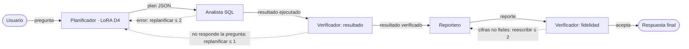
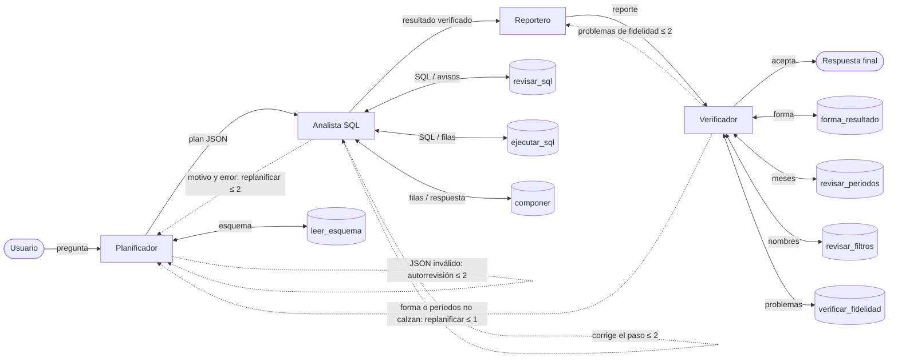

# Asistente SQL4Business

### Asistente de Consultas de Negocio: SQL y Reportes Ejecutivos Fieles a los Datos

Generative Artificial Intelligence (580694), Universidad de Concepción.

**Equipo:** Aredhel Jiménez, Bryan Riquelme, Guido Salazar y Vicente Soñez.

| Entregable | Documento | Reproducción |
|---|---|---|
| Deliverable 1 | [`docs/deliverable1.pdf`](docs/deliverable1.pdf) | [`notebooks/baseline_eval.ipynb`](notebooks/baseline_eval.ipynb) |
| Deliverable 2 | [`docs/deliverable2.pdf`](docs/deliverable2.pdf) · [video](https://drive.google.com/file/d/1ovemshyIkbVYasXr7zaFDXIrdrHN7OH5/view) | [`notebooks/deliverable2_demo.ipynb`](notebooks/deliverable2_demo.ipynb) |
| Deliverable 3 | [`docs/deliverable3.pdf`](docs/deliverable3.pdf) · [video](https://drive.google.com/file/d/1I9KuGPZe99HninfvLdC2E1XQjTf00EQZ/view?usp=sharing) | [`notebooks/deliverable3_demo.ipynb`](notebooks/deliverable3_demo.ipynb) |
| Deliverable 4 | [`docs/deliverable4.pdf`](docs/deliverable4.pdf) · [video](https://youtu.be/zXe4w0KGbcs) · adaptador: [`vicentesonez/sql4business-planificador-qlora`](https://huggingface.co/vicentesonez/sql4business-planificador-qlora) | [`scripts/modal_d4.py`](scripts/modal_d4.py) (Modal, corrida medida) · [`notebooks/deliverable4_finetune.ipynb`](notebooks/deliverable4_finetune.ipynb) (Colab) |

## Definición de la tarea

Se propone un asistente que, dada una pregunta de negocio, decide y ejecuta las consultas
SQL necesarias y redacta un resumen fiel a los resultados obtenidos. La pregunta puede ser
puntual, o combinada: en ese caso hay que identificar, relacionar y ejecutar varias
consultas para razonar cuál es la respuesta correcta. Una salida se considera correcta
cuando las consultas ejecutadas son las necesarias y suficientes para responder la pregunta,
y cuando cada cifra del resumen final es fiel a esos resultados.

Text-to-SQL es una tarea muy estudiada, pero la literatura casi siempre se detiene en la
exactitud de una única consulta. Este proyecto la extiende en dos direcciones poco
exploradas en modelos abiertos pequeños: planificar qué consultas se necesitan para
preguntas que combinan varios datos, y la fidelidad numérica del reporte.

## Datos

- `data/business.db`: base SQLite sintética de ventas e inventario (10 productos, 549
  ventas entre el 1 de marzo y el 31 de agosto de 2026), generada con semilla fija por
  `data/build_db.py`.
- `data/questions.json`: las 15 preguntas oficiales de Deliverable 1 (10 puntuales y 5
  combinadas), con el SQL y el resultado de referencia. No cambiaron. Solo se agregó
  `answer_fields` a q11, porque esa pregunta pide dos conteos y no un porcentaje.
- `data/paraphrases.json`: 12 paráfrasis de preguntas oficiales, 5 puntuales y 7
  combinadas (2 en inglés), con el mismo SQL y la misma respuesta de referencia. Es el
  conjunto externo (held-out): se escribió durante la auditoría y no se usa para diseñar
  el sistema.

Ambos JSON los genera `data/build_questions.py`, que ejecuta el SQL de referencia sobre
`business.db`.

## Deliverable 4: fine-tuning del Planificador

El Deliverable 4 ajusta (QLoRA) el modelo del **Planificador** del sistema de agentes del D3. Los otros
tres agentes siguen con el modelo base; el adaptador se carga una sola vez sobre el mismo modelo
(`Qwen/Qwen2.5-Coder-3B-Instruct`, revisión `488639f`, NF4) y se apaga para ellos.

- **Adaptador publicado:** [`vicentesonez/sql4business-planificador-qlora`](https://huggingface.co/vicentesonez/sql4business-planificador-qlora), revisión `0b5a6a6` (`results/deliverable4/adapter_hf.json` guarda el repo y la
  revisión exacta; la evaluación descarga esa revisión, así que los resultados son los de esos pesos).
- **Video:** [youtu.be/zXe4w0KGbcs](https://youtu.be/zXe4w0KGbcs): q12 y q11-p con el Planificador base y
  con el ajustado, sobre la misma entrada (`modal run scripts/modal_d4.py::demo --ids q12,q11-p`; trazas en
  `results/deliverable4/demo/`).

### Por qué el Planificador (evidencia del D3)

Del análisis de las 27 trazas de la corrida v2 (`results/deliverable3/trazas/`):

| Evidencia | Valor |
|---|---|
| Preguntas que el sistema falla (`e2e`) | 4: q04, q10, q12, q11-p |
| …cuyo error nace en un plan del Planificador | **4 de 4** (Analista, Reportero y Verificador no originan errores) |
| Veces que el Analista o el Verificador devolvieron el plan con un motivo | 6 |
| …en que el Planificador devolvió **el mismo SQL** | **4 de 6** (q04, q10, q12, q11-p) |

El prompting ya se agotó en el D3 (few-shot, descomposición, controles nuevos del Verificador y un
ejemplo más en v2): detectar funciona, corregir no. Con decodificación greedy, el sesgo por el orden en
que la pregunta nombra los períodos domina la retroalimentación. Por eso se cambia el comportamiento con
pesos, y un **control** mide si los mismos datos dados como prompt (ejemplos recuperados) bastan.

### Datos de entrenamiento (`data/finetune/`)

`python scripts/build_planner_data.py` los regenera de forma determinista (semilla 4); un test comprueba
que la salida es idéntica a la versionada. Código: [`src/sql4business/finetune_data.py`](src/sql4business/finetune_data.py).

| | |
|---|---|
| Entrada | el prompt exacto del Planificador en ejecución (`prompts/planificador.md` con todas las técnicas del D3, esquema enriquecido, pregunta; en reparaciones, también el plan anterior y la retroalimentación) |
| Salida | el plan JSON correcto (`answer_needs`, `periods`, `steps`, `composition`) |
| Fuente | plantillas de preguntas sobre `data/business.db`, 8 familias, 86 % español y 14 % inglés, con y sin tildes |
| Cómo se produce cada salida | **por código, sin ningún modelo generador**: el plan se construye a partir de los parámetros de la tarea, se ejecuta con las herramientas del Analista (validación, SQLite de solo lectura, composición) y se compara con un valor de referencia calculado en Python sobre las tablas; 0 discrepancias; se descartan empates |
| Tamaño | 1.282 ejemplos: 883 de plan y 399 de reparación; train 1.155 / dev 127, separados por cálculo |
| Reparación | 7 tipos de plan equivocado (×57): orden invertido (q12), filtro omitido (q04), participación como crecimiento (q11-p), dos valores con `direct` (q11), crecimiento en vez de comparar líderes (q10), listado en vez del primero (q03), mes corrido. La retroalimentación es la que produce `critic_problems`, la misma función del Verificador |
| Revisión | además de la verificación por ejecución de los 1.282 pares (fila anterior), se revisó a mano una muestra al azar de **60 ejemplos** (`data/finetune/revision_manual.csv`, semilla fija): pregunta, períodos, filtros, operación y, en las reparaciones, que la retroalimentación corresponda al plan equivocado. **60/60 correctos.** Observaciones: 6 preguntas leen "ventas" como número de transacciones, la convención que causa el caso de falla q09-p; 2 preguntas en inglés tienen redacción poco natural. Resultado fila por fila en [`data/finetune/revision_manual_resultado.csv`](data/finetune/revision_manual_resultado.csv) |
| Separación de la evaluación | de 4.737 tareas candidatas se eliminan 216 con la misma operación y resultados que una pregunta evaluada, 182 con algún paso numérico igual a un paso evaluado y 52 con similitud de 5-gramas ≥ 0,5. Máxima similitud restante: 0,19 (q15-p). `tests/test_finetune_data.py` lo comprueba |

Resumen completo en [`data/finetune/reporte.json`](data/finetune/reporte.json).

### Entrenamiento ([`scripts/train_planner.py`](scripts/train_planner.py))

QLoRA con un bucle propio en PyTorch + PEFT 0.22: base NF4 de 4 bits; LoRA r=16, α=32, dropout 0,05 en
`q,k,v,o,gate,up,down_proj`; AdamW, lr 2e-4, 5 % de calentamiento y coseno; 2 épocas; lote efectivo 8;
bf16 (`--dtype auto`: bf16 si la GPU lo tiene, fp16 en un T4); gradient checkpointing; largo máximo 2.560
tokens (el mayor ejemplo tiene 2.243). La pérdida se calcula solo sobre los tokens del plan. Salidas en
`results/deliverable4/adapter/`: `loss.csv`, `training_log.json` (configuración, hardware, versiones,
tiempo) y la tarjeta del modelo. Los pesos (`*.safetensors`) no se versionan en git: están en Hugging Face.

| Corrida medida (26-11-2026, commit `42b2a12`) | |
|---|---|
| Hardware | NVIDIA H100 80 GB en Modal (`scripts/modal_d4.py`), bf16 |
| Pasos / tiempo | 290 pasos (2 épocas × 145), 16,7 min |
| Parámetros entrenables | 29,9 M (LoRA r=16 en las 7 proyecciones) |
| Pérdida dev | 0,158 antes de entrenar → 0,009 a los 25 pasos → 0,0002 al final |
| Versiones | torch 2.11.0, transformers 5.17.0, peft 0.22.0, bitsandbytes 0.50.2 |

La pérdida dev cae casi a cero en pocos pasos: el Planificador aprende rápido el formato de las
plantillas. Por eso las paráfrasis externas son la prueba que importa, no la pérdida.

### Evaluación ([`scripts/evaluate_d4.py`](scripts/evaluate_d4.py))

Las mismas 27 preguntas y criterios, los cinco en la misma sesión:

| Configuración | Qué es |
|---|---|
| `baseline` | (1) prompt directo del D1 |
| `d2` | (2) pipeline del D2 |
| `agentes` | (3) sistema de agentes del D3, todos con el modelo base |
| `agentes_ft` | (4) el mismo sistema con el Planificador ajustado |
| `control_icl` | control: pesos base; el Planificador recibe en su prompt los 4 ejemplos de entrenamiento más parecidos ([`icl_control.py`](src/sql4business/icl_control.py)) |

Además se cuenta cuántas veces el Planificador repite un plan devuelto. Archivos:
`results/deliverable4/<config>.json`, una traza por pregunta en `results/deliverable4/trazas_<config>/`,
detalle por pregunta en `results/deliverable4/por_pregunta.md` y tabla del PDF en
`docs/deliverable4_results.tex`.

#### Corrida medida (26-11-2026, Modal H100, commit `ca38c00`, adaptador en la revisión `0b5a6a6`)

| Sistema | Oficial sql | answer | e2e | Paráfrasis sql | answer | e2e | Combinadas e2e | Llamadas |
|---|---|---|---|---|---|---|---|---|
| (1) Prompt directo (D1) | 8/15 | 9/15 | — | 3/12 | 5/12 | — | — | 1,0 |
| (2) Pipeline (D2) | 11/15 | 12/15 | 11/15 | 8/12 | 10/12 | 10/12 | 7/12 | 2,1 |
| (3) Agentes, modelo base (D3) | 11/15 | 12/15 | 12/15 | 8/12 | 11/12 | 11/12 | 9/12 | 3,5 |
| **(4) Agentes + Planificador ajustado (D4)** | **14/15** | **14/15** | **14/15** | 10/12 | 10/12 | 10/12 | 9/12 | 3,2 |
| Control: base + mismos datos en el prompt | 14/15 | 14/15 | 14/15 | 7/12 | 8/12 | 8/12 | 9/12 | 3,3 |

| Devoluciones al Planificador | Recibidas | Repitió el mismo plan |
|---|---|---|
| (3) base | 9 | 4 (q04, q10, q12, q11-p) |
| (4) ajustado | 1 | 1 (q10, que igual termina bien) |
| Control | 4 | 0 |

Detalle por pregunta (`e2e`; solo las que difieren entre configuraciones):

| Pregunta | Tipo | D2 | (3) base | (4) ajustado | Control |
|---|---|---|---|---|---|
| q04 | puntual | ✓ | ✗ | ✓ | ✓ |
| q09 | combinada | ✗ | ✓ | ✓ | ✓ |
| q10 | combinada | ✗ | ✗ | ✓ | ✗ |
| q11 | combinada | ✗ | ✓ | ✗ | ✓ |
| q12 | combinada | ✓ | ✗ | ✓ | ✓ |
| q13 | puntual | ✗ | ✓ | ✓ | ✓ |
| q09-p | combinada | ✗ | ✓ | ✗ | ✗ |
| q10-p | combinada | ✓ | ✓ | ✓ | ✗ |
| q11-p | combinada | ✓ | ✗ | ✗ | ✓ |
| q14-p | combinada | ✗ | ✓ | ✓ | ✓ |
| q07-p | puntual | ✓ | ✓ | ✓ | ✗ |
| q08-p | puntual | ✓ | ✓ | ✓ | ✗ |

Lectura:

- **Continuidad:** (3) en el H100 reproduce el D3 v2 medido en el T4 (12/15 y 11/12, con las mismas
  cuatro fallas: q04, q10, q12 y q11-p).
- **Qué logran los pesos nuevos:**
  - El Planificador ajustado resuelve q04, q10 y q12, justo los casos en que el base recibía la
    retroalimentación correcta y repetía su plan.
  - Casi siempre acierta al primer intento: 1 devolución contra 9.
  - En total sube de 23/27 a 24/27 en `e2e` y usa menos llamadas.
- **Lo que no mejora:** en paráfrasis baja de 11/12 a 10/12. Pierde q11 y q09-p (ver el caso de falla)
  y q11-p sigue fallando, ahora por otra razón.
- **Control:** los mismos datos dados como ejemplos en el prompt igualan al ajuste en el set oficial
  (14/15, preguntas parecidas a las plantillas), pero caen a 8/12 en paráfrasis. En las preguntas
  nuevas, los pesos generalizan mejor que el prompting con los mismos datos.
- **Tamaño:** con 27 preguntas, 1 o 2 de diferencia es una tendencia, no una diferencia significativa.

### Caso de falla

**q09-p** (paráfrasis externa; el sistema base la resolvía):

> ¿Cuánto crecieron, en porcentaje, las ventas de junio a agosto respecto de marzo a mayo?

- **Qué hace el sistema ajustado:** el Planificador pone bien el período anterior primero, que es lo
  que se entrenó. Pero mide *el número de transacciones* (`COUNT(*)`, 220 → 329, +49,5 %) en vez del
  *monto vendido* (48.748.530 → 78.058.920, +60,1 %).
- **Por qué:** en los datos de entrenamiento, las 222 preguntas que dicen "ventas" se etiquetaron como
  conteo de transacciones ("número de ventas", "producto con más ventas") y ninguna como monto. El
  ajuste aprendió esa convención de las plantillas. El modelo base, sin ese sesgo, leía "ventas" como
  monto en esta pregunta.
- **Por qué no lo detecta el Verificador:** la forma del resultado (un cambio porcentual) y los
  períodos calzan con la pregunta; ningún control revisa qué métrica se usó.
- **Traza:** [`results/deliverable4/trazas_agentes_ft/heldout_q09-p.json`](results/deliverable4/trazas_agentes_ft/heldout_q09-p.json).

**Mismo patrón en q11 y q11-p ("semestre").** El Planificador ajustado ya pone el total primero y la
parte después (la falla de q11-p en el D3). Sin embargo, traduce "el semestre" a julio–diciembre (q11)
o a enero–junio (q11-p), en vez de usar todo el período con datos (marzo–agosto). En los 35 ejemplos de
entrenamiento con "semestre", el plan correcto no filtra fechas, pero los 35 dicen "todo el semestre";
la forma "en el semestre" de estas preguntas no aparece. `revisar_periodos` no lo marca porque la
lista de chequeo del Verificador no fija fechas para "semestre". Trazas: `trazas_agentes_ft/official_q11.json`
y `trazas_agentes_ft/heldout_q11-p.json`.

Conclusión: el ajuste corrige el problema que se diagnosticó (repetir un plan devuelto, el orden de los
períodos), pero también copia las convenciones de las plantillas. Un siguiente paso sería variar en los
datos lo que significa "ventas" y los nombres de período.

### Cómo reproducir el Deliverable 4

**Ruta medida: Modal (H100).** Requiere `pip install modal`, `modal setup` y, solo para publicar, un
secreto `huggingface` con un token de escritura (`modal secret create huggingface HF_TOKEN=...`). Cada
comando clona el repositorio en un ref empujado (`--ref`, por defecto `deliverable4`) y deja los
resultados en las mismas rutas de este repositorio:

```
modal run scripts/modal_d4.py::train                 # QLoRA en H100 (~17 min) y publicación en Hugging Face
modal run scripts/modal_d4.py::evaluate              # cinco sistemas, 27 preguntas
modal run scripts/modal_d4.py::demo --ids q12,q11-p  # lo que muestra el video
```

Para solo reproducir los resultados no hace falta entrenar: `evaluate` descarga el adaptador publicado.

**Ruta alternativa: Colab.**

1. Abrir [`notebooks/deliverable4_finetune.ipynb`](https://colab.research.google.com/github/aredhel-jmze/Asistente-SQL-4-Business/blob/deliverable4/notebooks/deliverable4_finetune.ipynb) en Colab con GPU T4
   (mientras el D4 esté en la rama `deliverable4`; el notebook usa `REF = "deliverable4"`, cambiarlo a `main` tras el merge).
2. **Datos** (sin GPU): `python scripts/build_planner_data.py`.
3. **Entrenamiento** (unos 60–80 min): `python scripts/train_planner.py --push-to-hub <usuario>/sql4business-planificador-qlora`.
   Para solo reproducir resultados, saltar este paso: la evaluación descarga el adaptador publicado.
4. **Evaluación** (unos 60 min): `python scripts/evaluate_d4.py --resume`.
5. **Demo del video**: `python scripts/run_agents.py --id q12 --compare --no-baseline` muestra los mensajes
   entre agentes con el Planificador base y luego con el ajustado, sobre la misma entrada (trazas en
   `results/deliverable4/demo/q12_base.json` y `q12_ajustado.json`).
6. **PDF**: `cd docs && pdflatex deliverable4.tex` (incluye la curva de pérdida y la tabla generada).
7. **Tests sin GPU**: `python -m unittest discover -s tests`.

### Cambios en el código del D3

**Orden del Verificador (comentario del profesor al D3).** En el D3 el Analista entregaba un "resultado
verificado" directo al Reportero, y el Verificador revisaba todo al final, aunque sus controles del plan
(forma, períodos, filtros) no leen el reporte. Ahora el orden es Analista → Verificador (¿el resultado
responde la pregunta? si no, replanificar) → Reportero → Verificador (¿el reporte es fiel? si no,
reescribir) → usuario:



Las decisiones y la retroalimentación son las mismas: `tests/test_agents.py` reproduce sin GPU las 27
trazas de la corrida v2 del D3 con el nuevo orden y obtiene los mismos planes, la misma retroalimentación
al Planificador, el mismo resultado y el mismo estado. Cambian dos cosas: el Reportero ya no redacta un
resultado que vuelve al Planificador (menos llamadas), y el reporte de respaldo (cuando el plan nuevo
falla) ahora también pasa por el chequeo de fidelidad; en el D3 quedaba sin verificar. Los sistemas (3),
(4) y el control del D4 se evalúan con este orden.

Además, dos cambios sin efecto en las decisiones:
los controles del Verificador se extrajeron a `critic_problems` (para que los datos usen su mismo texto),
y `AgentSystem` acepta un generador propio por agente (`agent_generators`). Además, el modelo base queda
fijado en la revisión `488639f`, la evaluada desde el D2.

## Deliverable 3: sistema de agentes

El Deliverable 3 reconstruye la solución del D2 como un sistema de **cuatro agentes**. Cada agente
es una llamada al mismo modelo (`Qwen/Qwen2.5-Coder-3B-Instruct`, NF4 de 4 bits, greedy, Colab T4)
con un rol, un prompt propio guardado como archivo versionado en [`prompts/`](prompts/), una entrada
y una salida definidas, y una decisión sobre qué pasa después. Las piezas deterministas del D2
(esquema enriquecido, SQL de solo lectura, composición, verificación de fidelidad) pasan a ser
herramientas de los agentes; el código del D2 (`pipeline.py`) no cambia y se sigue evaluando.



### Agentes

| Agente | Prompt | Recibe | Devuelve | Herramientas | Decide / se detiene |
|---|---|---|---|---|---|
| Planificador | [`planificador.md`](prompts/planificador.md) | pregunta, esquema, retroalimentación opcional | plan JSON: pasos SQL y operación (+ lo que pide la respuesta y los períodos) | `leer_esquema` | entrega el plan al Analista; si su JSON es inválido, revisa su propia salida (≤ 2) |
| Analista SQL | [`analista_sql.md`](prompts/analista_sql.md) | plan JSON | filas por paso y respuesta compuesta, o un motivo para replanificar | `revisar_sql`, `ejecutar_sql`, `componer` | solo llama al modelo si una herramienta falla: corrige un paso, invierte el orden de dos pasos (≤ 2 por plan) o devuelve el plan al Planificador (≤ 2 replanificaciones) |
| Reportero | [`reportero.md`](prompts/reportero.md) | pregunta, resultado verificado, problemas opcionales | una o dos oraciones en el idioma de la pregunta | — | entrega al Verificador; reescribe si el Verificador lo rechaza (≤ 2) |
| Verificador | [`verificador.md`](prompts/verificador.md) | pregunta, resultado, reporte | veredicto: aceptar, revisar el reporte o replanificar | `forma_resultado`, `revisar_periodos`, `revisar_filtros`, `verificar_fidelidad` | el modelo lee solo la pregunta y declara qué tipo de respuesta pide y qué períodos nombra; si el resultado no calza, devuelve el caso al Planificador (≤ 1); si el reporte no es fiel, al Reportero; si no, acepta |

Por qué esta división: entender la pregunta, interactuar con la base, redactar y juzgar son
competencias distintas, y quien juzga no debe ser quien produjo el trabajo. Cuando se agotan los
presupuestos, el sistema entrega la mejor respuesta anterior (estado `respaldo`) o declara que no
pudo responder. Código: [`src/sql4business/agents.py`](src/sql4business/agents.py).

#### Qué decide cada agente y quién toma la decisión

Cada agente decide qué pasa después a partir de lo que observa. En algunos casos la decisión la toma
el modelo; en otros, una regla fija aplicada a lo que observaron el modelo y las herramientas. Se
separan para no atribuirle al modelo decisiones que toma el código.

| Agente | Qué observa | Decisión | Quién decide |
|---|---|---|---|
| Planificador | pregunta, esquema y, si vuelve, el motivo del rechazo y su plan anterior | qué pasos SQL y qué operación de composición usar (`direct`, `growth_pct`, `share_pct`, `compare_equal`, `filter_then_rank`); esa operación define qué hará `componer` | modelo |
| Planificador | error de validación de su propio JSON | revisar su salida (≤ 2) | regla (el validador falla) |
| Analista SQL | error de `revisar_sql`, `ejecutar_sql` o `componer` | corregir un paso, invertir dos pasos o devolver el plan con un motivo | modelo (`action`: `fix`, `swap`, `replan`) |
| Analista SQL | todas las herramientas sin error | entregar el resultado al Reportero sin llamar al modelo | regla |
| Reportero | resultado verificado y, si vuelve, los problemas encontrados | qué cifras citar y cómo redactarlas; al volver, reescribir su propia salida | modelo |
| Verificador | la pregunta (sin ver el plan) | qué tipo de respuesta pide y qué períodos nombra (lista de chequeo) | modelo |
| Verificador | la lista de chequeo frente a `forma_resultado`, `revisar_periodos`, `revisar_filtros` y `verificar_fidelidad` | replanificar, devolver el reporte o aceptar | regla sobre esas observaciones |

En la corrida v2, el Analista consultó al modelo 2 veces en 27 preguntas: con el esquema enriquecido
casi no hubo errores de SQL que decidir. Por eso su técnica no se puede medir en este conjunto (ver
la ablación).

### Técnicas de prompting y ablación

Clasificadas con la taxonomía de Schulhoff et al. (2024) [7]. Todos los agentes usan *role
prompting* y salida estructurada. Cada técnica está marcada como un bloque `[[técnica]]` en el
archivo del prompt (o como una rama del código) y se puede apagar por separado:

| Técnica | Agente | Falla que ataca (D2) | Configuración sin ella |
|---|---|---|---|
| Few-shot: tres ejemplos resueltos que no pertenecen a ningún conjunto de evaluación [8] | Planificador | listados en vez del primero (q03), `strftime('%Q')` (q10) | `sin_few_shot` |
| Descomposición explícita (*plan-and-solve*): qué debe contener la respuesta y los períodos antes del SQL [9] | Planificador | una sola consulta para preguntas de varios valores (q11, q09-p) | `sin_decomposition` |
| Autocorrección guiada por herramientas (*self-debugging*): el error de SQLite, del linter o de la composición vuelve al modelo [10] | Analista SQL | filtros de fecha y sintaxis (q09, q10) | `sin_self_correction` |
| Verificación con lista de chequeo (*self-verification*) contrastada con herramientas: forma del resultado, pasos descartados, meses y su orden, nombres de la base citados en la pregunta [11] | Verificador | resultados válidos que no responden la pregunta (q03, q11, q09-p, q14-p) | `sin_critic` |
| Refinamiento con retroalimentación (*self-refine*) [12] | Reportero | cifras no respaldadas en el reporte (q13) | `sin_report_refine` |

`tests/test_agents.py` reproduce los planes que fallaron en la corrida v3 del D2 y comprueba que las
herramientas los devuelven al agente que corresponde.

### Trazas

Cada pregunta deja una traza con todos los mensajes entre agentes y herramientas, en orden:
`n`, `de`, `para`, `tipo`, `contenido` y, cuando corresponde, la `salida_modelo` cruda.

- `results/deliverable3/trazas/<set>_<id>.json`: una por pregunta del sistema completo (incluye el
  caso de falla).
- `results/deliverable3/demo/<id>.json`: las preguntas que se muestran en el video.

### Evaluación del Deliverable 3

Ocho configuraciones sobre las mismas 27 preguntas y con el mismo criterio (`sql`, `answer`,
`report`, `e2e`, definidos en la evaluación del Deliverable 2): `baseline` (prompt directo del D1), `d2` (solución del D2),
`agentes` (sistema completo) y una ablación por técnica (`sin_<técnica>`). También se informa el
promedio de llamadas al modelo por pregunta.

#### Corrida v1 (26-10-2026, Colab T4, commit `351d435`)

Resultados en [`results/deliverable3_v1/`](results/deliverable3_v1/), con una traza por pregunta.
`baseline` y `d2` de esa sesión siguen vigentes (su código no cambió) y se copian en
`results/deliverable3/`.

| Configuración | Oficial sql | answer | e2e | Paráfrasis sql | answer | e2e | Llamadas |
|---|---|---|---|---|---|---|---|
| Baseline D1 | 7/15 | 8/15 | — | 3/12 | 5/12 | — | 1,0 |
| Solución D2 | 11/15 | 11/15 | 10/15 | 8/12 | 10/12 | 10/12 | 2,1 |
| Agentes v1 | 11/15 | 11/15 | 9/15 | 9/12 | 11/12 | 9/12 | 3,8 |
| sin few-shot | 9/15 | 10/15 | 9/15 | 8/12 | 10/12 | 9/12 | 3,7 |
| sin descomposición | 11/15 | 13/15 | 11/15 | 6/12 | 8/12 | 7/12 | 3,6 |
| sin autocorrección | 11/15 | 11/15 | 9/15 | 9/12 | 11/12 | 9/12 | 3,6 |
| sin verificación crítica | 11/15 | 11/15 | 9/15 | 8/12 | 10/12 | 9/12 | 2,4 |
| sin refinamiento | 11/15 | 11/15 | 9/15 | 9/12 | 11/12 | 8/12 | 3,4 |

Qué mostró v1: los agentes resolvieron fallos del D2 (q03, q09, q09-p, q14-p), pero aparecieron
fallos nuevos:

- **El Reportero inventó cifras** en q06, q08, q08-p y q14-en (períodos y porcentajes que no
  existen). Imitaba el ejemplo de cambio porcentual que se le agregó a todas las preguntas, y al
  corregir copiaba su respuesta rechazada.
- **Planes que el Verificador no podía ver:** a q04 le faltó el filtro de categoría; q12 puso agosto
  antes que marzo y calculó una caída; q11 calculó el total y la parte pero el plan directo descartó
  el total.
- En q11-p el Analista no supo ordenar total y parte, y en q10 el Verificador clasificó mal la pregunta.

#### Versión 2 (cambios tras v1)

- **Reportero (v3 del prompt):** la indicación de cambio porcentual solo aparece cuando la respuesta
  es un cambio porcentual, y al corregir no recibe la respuesta rechazada, solo los problemas.
- **Verificador:** nueva herramienta `revisar_filtros` (nombres exactos de la base que la pregunta
  menciona y ningún paso usa), control de orden de los períodos en un cambio porcentual y de pasos
  descartados por un plan directo, y dos ejemplos más en su lista de chequeo.
- **Analista:** acción `swap` para invertir dos pasos, y deja de insistir si su corrección no cambia
  el SQL.

Antes de correr v2 se reprodujeron sin GPU los planes de v1 con las herramientas nuevas: marcan los
7 planes equivocados y ninguno de los correctos.

#### Corrida v2 (27-10-2026, Colab T4, commit `087cffc`): versión final

Resultados en [`results/deliverable3/`](results/deliverable3/), con una traza por pregunta en
`trazas/` y las de la demo en `demo/`. La tabla del PDF
([`docs/deliverable3_results.tex`](docs/deliverable3_results.tex)) se genera desde esos archivos.

| Configuración | Oficial sql | answer | e2e | Paráfrasis sql | answer | e2e | Llamadas |
|---|---|---|---|---|---|---|---|
| Baseline D1 | 7/15 | 8/15 | — | 3/12 | 5/12 | — | 1,0 |
| Solución D2 | 11/15 | 11/15 | 10/15 | 8/12 | 10/12 | 10/12 | 2,1 |
| Agentes v1 | 11/15 | 11/15 | 9/15 | 9/12 | 11/12 | 9/12 | 3,8 |
| **Agentes v2** | **11/15** | **12/15** | **12/15** | **9/12** | **11/12** | **11/12** | 3,6 |
| sin few-shot | 9/15 | 10/15 | 10/15 | 8/12 | 10/12 | 10/12 | 3,4 |
| sin descomposición | 10/15 | 13/15 | 13/15 | 6/12 | 8/12 | 8/12 | 3,3 |
| sin autocorrección | 11/15 | 12/15 | 12/15 | 9/12 | 11/12 | 11/12 | 3,5 |
| sin verificación crítica | 11/15 | 11/15 | 11/15 | 8/12 | 10/12 | 10/12 | 2,1 |
| sin refinamiento | 11/15 | 12/15 | 12/15 | 9/12 | 11/12 | 10/12 | 3,6 |

- **Mejora frente al D2 (`e2e`):** 12/15 contra 10/15 en el set oficial y 11/12 contra 10/12 en
  paráfrasis. En preguntas combinadas, 3/5 contra 2/5 y 6/7 contra 5/7. La mejora neta esconde
  cambios en ambos sentidos: los agentes resuelven 6 preguntas que el D2 fallaba (q03, q09, q11, q13,
  q09-p, q14-p) y pierden 3 que el D2 resolvía (q04, q12, q11-p; ver el caso de falla).
- **Ablación:**
  - Sin few-shot se pierden 2 preguntas oficiales y 1 paráfrasis.
  - Sin el Verificador se pierde 1 en cada conjunto: sus replanificaciones corrigieron q11 y q08-p.
  - Sin refinamiento se pierde un reporte (q10-p).
  - La descomposición suma 3 combinadas en paráfrasis (q09-p, q10-p, q12-en), pero cuesta una
    puntual oficial (q04).
  - La autocorrección del Analista **no se puede medir en este conjunto**: el Analista consultó al
    modelo solo 2 veces en las 27 preguntas (q11-p), porque con el esquema enriquecido casi no hubo
    errores de SQL. Quitarla deja los mismos resultados, pero eso no muestra que no aporte: la técnica
    casi no se activó.
- **Tamaño de las diferencias:** cada ablación difiere del sistema completo en 0 a 5 preguntas de 27,
  y a veces en ambos sentidos: sin few-shot se pierden q02, q07, q11 y q10-p, pero se gana q04. Con
  conjuntos así de chicos, una diferencia de una o dos preguntas indica una tendencia, no una
  diferencia significativa; por eso se muestra el detalle por pregunta.
- **Costo:** 3,6 llamadas y unos 33 s por pregunta, contra 2,1 llamadas y 15 s del D2.

#### Detalle por pregunta (`e2e`, corrida v2)

Solo las 14 preguntas en que alguna configuración difiere; las otras 13 las resuelven todas (✓ correcta,
✗ incorrecta). La baseline no tiene `e2e` y se omite.

| Pregunta | Tipo | D2 | Agentes v2 | sin few-shot | sin descomp. | sin autocorr. | sin verif. | sin refin. |
|---|---|---|---|---|---|---|---|---|
| q02 | puntual | ✓ | ✓ | ✗ | ✓ | ✓ | ✓ | ✓ |
| q03 | puntual | ✗ | ✓ | ✓ | ✓ | ✓ | ✓ | ✓ |
| q04 | puntual | ✓ | ✗ | ✓ | ✓ | ✗ | ✗ | ✗ |
| q07 | puntual | ✓ | ✓ | ✗ | ✓ | ✓ | ✓ | ✓ |
| q09 | combinada | ✗ | ✓ | ✓ | ✓ | ✓ | ✓ | ✓ |
| q11 | combinada | ✗ | ✓ | ✗ | ✓ | ✓ | ✗ | ✓ |
| q12 | combinada | ✓ | ✗ | ✗ | ✗ | ✗ | ✗ | ✗ |
| q13 | puntual | ✗ | ✓ | ✓ | ✓ | ✓ | ✓ | ✓ |
| q08-p | puntual | ✓ | ✓ | ✓ | ✓ | ✓ | ✗ | ✓ |
| q09-p | combinada | ✗ | ✓ | ✓ | ✗ | ✓ | ✓ | ✓ |
| q10-p | combinada | ✓ | ✓ | ✗ | ✗ | ✓ | ✓ | ✗ |
| q11-p | combinada | ✓ | ✗ | ✗ | ✗ | ✗ | ✗ | ✗ |
| q12-en | combinada | ✓ | ✓ | ✓ | ✗ | ✓ | ✓ | ✓ |
| q14-p | combinada | ✗ | ✓ | ✓ | ✓ | ✓ | ✓ | ✓ |

La tabla se obtiene de `results/deliverable3/<config>.json` (campo `e2e` de cada registro).

#### Caso de falla (v2): q12

> ¿El ingreso de agosto de 2026 fue mayor o menor que el de marzo de 2026, y en qué porcentaje?

- **Qué hace el sistema:** el Planificador ordena los pasos como los nombra la pregunta (agosto antes
  que marzo), y el código calcula una caída de 37,14 % en vez de un alza de 59,08 %.
- **Qué detecta:** el control de orden de `revisar_periodos` marca que el período posterior va
  primero, y el Verificador devuelve el plan con el motivo exacto (mensaje 24 de la traza de la
  evaluación). En esa traza, `revisar_periodos` informa "todos cubiertos" (mensaje 21) porque en la
  corrida v2 solo se registraba la cobertura de meses, no el control de orden. Desde el 29-10 ambos
  controles quedan en la salida de la herramienta, sin cambiar ninguna decisión; la traza regenerada
  está en [`results/deliverable3/demo/q12.json`](results/deliverable3/demo/q12.json).
- **Por qué igual falla:** el Planificador repite el mismo plan. La decodificación es greedy y el
  sesgo por el orden en que la pregunta nombra los meses es fuerte. Agotado el reintento del
  Verificador, el sistema acepta.
- **Otros casos con el mismo patrón:** q04 (falta el filtro `Alimentos`) y q11-p (total y parte en
  orden inverso). En los tres, el problema se detecta pero el agente que debe corregirlo ignora la
  retroalimentación.

Traza: [`results/deliverable3/trazas/official_q12.json`](results/deliverable3/trazas/official_q12.json).
En q10 el Verificador lee la pregunta como un listado, así que su devolución no apunta al error real
(el plan calcula un crecimiento en vez de comparar líderes).

### Cómo reproducir el Deliverable 3

1. Abrir [`notebooks/deliverable3_demo.ipynb`](https://colab.research.google.com/github/aredhel-jmze/Asistente-SQL-4-Business/blob/main/notebooks/deliverable3_demo.ipynb)
   en Colab con GPU T4.
2. **Prueba corta** (unos 5 minutos): `python scripts/evaluate_d3.py --limit 2 --configs agentes`.
3. **Demo del video**: `python scripts/run_agents.py --id q09-p` imprime en vivo cada mensaje entre
   agentes, con la baseline sobre la misma entrada, y guarda la traza. `--without critic` (u otra
   técnica) muestra el sistema sin esa técnica. El caso de falla se muestra con
   `python scripts/run_agents.py --id q12 --no-baseline` (traza en `results/deliverable3/demo/q12.json`).
4. **Evaluación completa** (unas 2 horas): `python scripts/evaluate_d3.py --resume`. Si Colab se
   desconecta, la misma orden continúa desde la última configuración guardada.
5. **PDF**: `cd docs && pdflatex deliverable3.tex` (incluye la tabla generada).
6. **Tests sin GPU**: `python -m unittest discover -s tests`. Usan un modelo simulado
   (`tests/oracle.py` y respuestas guionadas) para probar los agentes, los ciclos, las trazas y la
   evaluación de punta a punta.

### Desviaciones declaradas del Deliverable 3

- Nueva herramienta `revisar_sql`: un linter que detecta comparar `strftime('%Y-%m', ...)` con fechas
  completas, el error silencioso del caso de falla del D2 (q09).
- El prompt del Reportero agrega dos reglas: no mencionar pasos, SQL ni ids (en el D2, "paso 1" en
  q13 contaba como cifra no respaldada) e informar un cambio porcentual una sola vez.
- `verificar_fidelidad` (compartida por el D2 y el D3) rechaza un reporte que repite el cambio
  porcentual, como si cada período hubiera crecido en esa cifra ("aumentaron un 60.13% entre marzo y
  mayo y un 60.13% entre junio y agosto", visto en la prueba de q09-p). Aplicada a la corrida v3 del
  D2, no cambia ningún veredicto.
- Los ejemplos del Planificador y del Verificador usan la misma base, pero ninguna pregunta de los
  conjuntos de evaluación (un test lo comprueba). Cubren los mismos tipos de operación, por lo que su
  aporte se mide con la ablación `sin_few_shot`.
- La baseline y la solución del D2 se volvieron a correr sin cambios en la sesión de v1, para comparar
  todo con las mismas versiones.
- Los cambios de v2 se definieron mirando fallos de ambos conjuntos; por eso, para v2, las
  paráfrasis dejan de ser un conjunto estrictamente externo. Los resultados de v1 se conservan.
- Después de la corrida v2 (29-10) solo cambió el registro de la traza: `forma_resultado` informa
  también los pasos descartados y `revisar_periodos` el orden de los períodos, dos controles que el
  Verificador ya aplicaba pero que no quedaban como salida de una herramienta. Los mensajes de
  retroalimentación y las decisiones no cambian: un test reproduce las 27 trazas de v2 con las salidas
  del modelo guardadas en ellas y obtiene los mismos mensajes. Por eso los resultados de
  v2 siguen vigentes. Las trazas de `trazas/` son de la corrida v2; las de `demo/` usan el registro
  nuevo.

## Sistema (Deliverable 2)

**Modelo:** `Qwen/Qwen2.5-Coder-3B-Instruct`, cuantizado en NF4 de 4 bits con cómputo
bf16 y decodificación greedy, en una GPU T4 de Colab (el hardware declarado en
Deliverable 1). Es el menor de los tres candidatos y empató el mejor baseline propio
(46,7 %). Qwen-7B cuesta más parámetros sin ventaja local, y Llama-3.1-8B es mayor,
requiere acceso restringido y obtuvo el mismo 46,7 %.

**Intervención contra el fallo diagnosticado.** En Deliverable 1, el prompting directo
obtuvo 0/5 en preguntas combinadas. Los errores eran fechas inventadas, categorías
traducidas, sintaxis de otros motores y tratar una pregunta combinada como una sola
consulta. La solución separa planificar de calcular:

```
pregunta ─► esquema enriquecido ─► plan JSON (Qwen 3B) ─► SQL de solo lectura ─► composición ─► reporte (Qwen 3B) ─► verificación
            valores exactos,        pasos + operación      validación; un paso   determinista    idioma de la       cada cifra debe
            rango de fechas, joins  elegida por el modelo  puede leer otro;      (crecimiento,   pregunta           salir de la
                                         ▲                 reparación ≤ 2        participación,                     respuesta
                                         └──── error ◄─────┘                     comparación, filtro+ranking)
```

- `src/sql4business/sql_tools.py`: esquema enriquecido y ejecución de solo lectura
  (conexión `mode=ro`, validación que ignora literales, rechazo de años sin datos).
- `src/sql4business/pipeline.py`: plan, ejecución con referencias entre pasos (como
  CTE), composición, reporte y hasta dos reparaciones con el mensaje de error.
- `src/sql4business/composition.py`: operaciones deterministas; los errores de forma
  activan la reparación.
- `src/sql4business/fidelity.py`: verificación del reporte. Toda cifra debe coincidir con
  la respuesta verificada o con la evidencia (pregunta, SQL, filas) a la precisión en que
  está escrita, y se controla la dirección del cambio y la afirmación de si "cambió".
  Si el modelo no entrega un reporte válido, se muestra un resumen determinista y cuenta
  como fallo.
- `src/sql4business/evaluation.py`: evaluación compartida por el script y el notebook.

## Evaluación (Deliverable 2)

Se comparan tres sistemas sobre las mismas entradas y con los mismos criterios:

| Sistema | Qué es |
|---|---|
| Baseline | Prompt directo de Deliverable 1, literal, con el esquema simple |
| Alternativa | El mismo prompt directo con el esquema enriquecido |
| Solución | El pipeline estructurado |

| Métrica | Criterio |
|---|---|
| `sql` | Criterio de Deliverable 1: cada conjunto de filas de referencia es producido exactamente por alguna consulta ejecutada |
| `answer` | La respuesta final es correcta, sin importar cómo se llegó a ella. Por ejemplo, una sola consulta que devuelve el producto ganador cuenta |
| `report` | (solo solución) el reporte escrito por el modelo pasa la verificación de fidelidad |
| `e2e` | (solo solución) `answer` y `report` correctos a la vez |

### Resultados

Corrida v3: 24-09-2026, Colab T4, commit `d0c33b6`. Detalle por pregunta, trazas y
versiones en [`results/deliverable2_v3.json`](results/deliverable2_v3.json); la tabla del
PDF se genera desde ese archivo.

| Conjunto | Sistema | `sql` | `answer` | `report` | `e2e` |
|---|---|---|---|---|---|
| Oficial (15, in-sample) | Baseline (D1) | 7/15 | 8/15 | — | — |
| | Alternativa (esquema enriquecido) | 8/15 | 10/15 | — | — |
| | **Solución** | **11/15** | **11/15** | 12/15 | **10/15** |
| Paráfrasis (12, held-out) | Baseline (D1) | 3/12 | 5/12 | — | — |
| | Alternativa (esquema enriquecido) | 4/12 | 8/12 | — | — |
| | **Solución** | **8/12** | **10/12** | 11/12 | **10/12** |

- **Preguntas combinadas (`answer`):** en el set oficial, baseline 1/5, alternativa 1/5 y
  solución 2/5; en paráfrasis, 2/7, 4/7 y 5/7.
- **De dónde viene la mejora:** el esquema enriquecido explica casi toda la mejora en
  puntuales (9/10 respuestas oficiales, contra 7/10 de la baseline). La descomposición con
  composición determinista suma las combinadas.
- **Costo:** 16,3 s por pregunta, contra 6,2 s de la baseline, en T4.

### Casos de fallo y límites conocidos

- **q09 (caso de fallo principal):** el planificador filtra con
  `strftime('%Y-%m', sale_date) BETWEEN '2026-03-01' AND '2026-05-31'`. Comparar `'2026-03'`
  con una fecha completa deja fuera marzo y junio, así que el crecimiento calculado es 70,06 %
  en vez de 60,13 %. El SQL es válido, el resultado es un solo número y el reporte es fiel a
  él: ni la validación, ni la reparación, ni el verificador pueden detectarlo, porque
  revisan forma y cifras, no el significado de un predicado.
- **q10:** el modelo vuelve a usar `strftime('%Q')` en los tres intentos pese al mensaje de
  error; los reintentos no corrigen sesgos fuertes del modelo.
- **q03 y q11:** el plan no se limita al primer producto (q03) u omite el total (q11). En
  q09-p el planificador responde con un solo paso y el reportero inventa porcentajes, que el
  verificador rechaza.
- **Verificador:** controla cifras, no su atribución. Acepta "488" presentado como total
  (q11) y un id de producto sacado de un paso (q14-p). Además es conservador: rechaza
  "paso 1" en q13.
- **Validez:** los resultados oficiales son in-sample, y ambos conjuntos son chicos (27
  preguntas sobre datos sintéticos).

## Cómo reproducir (Deliverable 2)

1. **Todo lo del PDF y el video, en Colab:** abrir
   [`notebooks/deliverable2_demo.ipynb`](https://colab.research.google.com/github/aredhel-jmze/Asistente-SQL-4-Business/blob/main/notebooks/deliverable2_demo.ipynb),
   elegir `Runtime > Change runtime type > T4 GPU` y luego `Run all`. El notebook clona este
   repositorio en `REF`, instala `requirements.txt` (versiones fijadas), corre la demo y la
   evaluación completa (unos 20–25 minutos) y escribe `results/deliverable2_v3.json` y
   `docs/deliverable2_results.tex`. No hay que subir archivos ni tener cuenta en Hugging Face.
   La versión versionada del notebook ya incluye las salidas de la corrida v3.
2. **Tests sin GPU** (Python 3.8 o superior, sin dependencias):
   `python -m unittest discover -s tests`.
3. **Scripts con GPU:** `pip install -r requirements.txt` y luego:
   - `python scripts/run_question.py --id q09-p`: una pregunta, baseline y solución sobre
     la misma entrada; también acepta el texto de la pregunta.
   - `python scripts/evaluate.py --tex docs/deliverable2_results.tex`: la evaluación
     completa.
4. **PDF:** `cd docs && pdflatex deliverable2.tex`. La tabla de resultados la incluye
   desde `deliverable2_results.tex`.
5. **Datos:** `cd data && python build_db.py && python build_questions.py` regenera
   exactamente los archivos versionados.

Qué muestra el video: la celda de demo del notebook, que corre la baseline y la solución
sobre la misma pregunta (por defecto `q09-p`, la primera paráfrasis, sin elegirla por su
resultado), y el resumen de la evaluación.

## Estructura del repositorio

```
.
├── data/                 Base sintética, generadores, los dos conjuntos de preguntas y finetune/ (D4)
├── docs/                 PDF y fuentes LaTeX de D1, D2 y D3, tablas generadas, enunciado de D2
├── notebooks/            baseline_eval.ipynb (D1), deliverable2_demo.ipynb y deliverable3_demo.ipynb (Colab)
├── prompts/              Prompt de cada agente del D3, un archivo versionado por agente
├── results/              Resultados de D1, D2 (v1, v2, v3), D3 (deliverable3/) y D4 (deliverable4/), con trazas
├── scripts/              D2: evaluate.py, run_question.py · D3: evaluate_d3.py, run_agents.py · D4: build_planner_data.py, train_planner.py, evaluate_d4.py
├── src/sql4business/     Código del asistente (D2: pipeline.py; D3: agents.py) y de la evaluación
├── tests/                Tests por módulo, sin GPU (modelo simulado)
└── artifacts/            Contexto de trabajo con IA y auditoría de D2
```

## Historial y desviaciones declaradas

- **Deliverable 1** (`results/baseline_*`): prompting directo con los tres candidatos,
  sobre las 15 preguntas oficiales.

  | Modelo | Puntual | Combinada | Global |
  |---|---|---|---|
  | Qwen2.5-Coder-7B-Instruct | 50 % | 0 % | 33,3 % |
  | Qwen2.5-Coder-3B-Instruct | 70 % | 0 % | 46,7 % |
  | Llama-3.1-8B-Instruct | 70 % | 0 % | 46,7 % |

- **Deliverable 2 v1** (17-09, `results/deliverable2_v1.json`): 12/15 con el criterio SQL.
  La auditoría ([`artifacts/auditoria-deliverable-2.md`](artifacts/auditoria-deliverable-2.md))
  encontró cuatro problemas:
  - el tipo de operación lo fijaba un clasificador con palabras copiadas de las 5 preguntas
    combinadas (0/7 en paráfrasis);
  - la baseline no era la de D1;
  - el criterio penalizaba respuestas correctas de una sola consulta;
  - el validador de reportes no medía fidelidad.
- **Deliverable 2 v2** (24-09, commit `2d99f37`, `results/deliverable2_v2.json`): corrige
  lo anterior. Elimina las reglas específicas de las preguntas, vuelve a la baseline de D1,
  agrega una métrica de respuesta común y un nuevo validador. En esa corrida el reportero
  descartó 5 reportes en texto plano por no ser JSON. En ese archivo el texto del reporte
  está en `raw_report`, porque la clave `report` guarda la métrica.
- **Deliverable 2 v3** (24-09, commit `d0c33b6`, `results/deliverable2_v3.json`, versión
  final): solo cambia el formato de salida del reportero, que acepta texto plano. El SQL y
  las respuestas son idénticos a v2 en las 27 preguntas.
- Las 15 preguntas oficiales se usaron para desarrollar el sistema (in-sample); la
  estimación de generalización es el conjunto de paráfrasis.
- **Cambio de plan respecto de D1:** D1 anunciaba fine-tuning QLoRA para este entregable,
  pero no se aplicó. Se optó por una intervención sin entrenamiento (planificación,
  herramientas y composición determinista), porque el fallo diagnosticado es de
  planificación y cálculo más que de conocimiento de SQL.
- **Idioma:** el documento técnico está en español; el reporte del asistente se escribe en
  el idioma de la pregunta.

## Referencias

1. CogniSQL-R1-Zero: Lightweight Reinforced Reasoning for Efficient SQL Generation. arXiv:2507.06013, 2025.
2. JudgeSQL: Reasoning over SQL Candidates with Weighted Consensus Tournament. arXiv:2510.15560, 2025.
3. TinyLLM: Evaluation and Optimization of Small Language Models for Agentic Tasks on Edge Devices. arXiv:2511.22138, 2025.
4. Mahapatra, Roy, Garain. Factual Inconsistency in Data-to-Text Generation Scales Exponentially with LLM Size. arXiv:2502.12372, 2025.
5. Hui, Yang, et al. Qwen2.5-Coder Technical Report. arXiv:2409.12186, 2024.
6. Li et al. Can LLM Already Serve as A Database Interface? A BIg Bench for Large-Scale Database Grounded Text-to-SQLs. NeurIPS 2023 (arXiv:2305.03111).

7. Schulhoff et al. The Prompt Report: A Systematic Survey of Prompting Techniques. arXiv:2406.06608, 2024.
8. Brown et al. Language Models are Few-Shot Learners. NeurIPS 2020 (arXiv:2005.14165).
9. Wang et al. Plan-and-Solve Prompting. ACL 2023 (arXiv:2305.04091).
10. Chen, Lin, Schärli, Zhou. Teaching Large Language Models to Self-Debug. arXiv:2304.05128, 2023.
11. Dhuliawala et al. Chain-of-Verification Reduces Hallucination in Large Language Models. arXiv:2309.11495, 2023.
12. Madaan et al. Self-Refine: Iterative Refinement with Self-Feedback. NeurIPS 2023 (arXiv:2303.17651).
